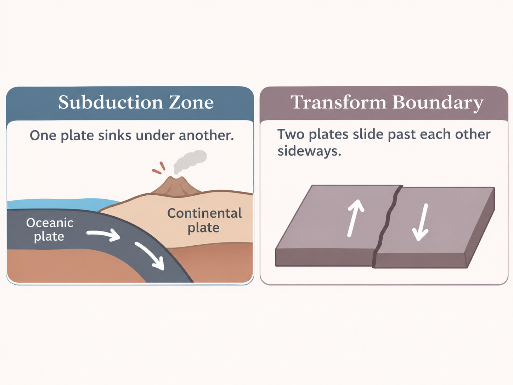

## 1. Introduction

When I took an earth science class in high school, I learned about tectonic plates and how earthquakes tend to occur near their boundaries. I found it interesting that some regions experience earthquakes more frequently than others, and how the characteristics of earthquakes may differ depending on their geographic locations.

One thing I became curious about was whether earthquakes have different magnitudes and depths depending on where they occur.

### Tectonic Plate Boundaries

Earthquakes often occur near tectonic plate boundaries, but not all boundaries are the same.

Japan and Peru are located near **subduction zones**, where one tectonic plate moves beneath another. These regions can experience earthquakes at various depths. On the other hand, California is located near a **transform boundary**, where two plates slide past each other horizontally. Earthquakes associated with this type of boundary are generally shallow.

{fig-alt="Explanation of subduction zone where one plane sinks under another and transform boundary, where two plates slide past each other sideways."}

Based on these differences, I wanted to explore whether earthquake characteristics differ across these regions.

## 2. Research Question

My main research question is:

**How do earthquake magnitudes and depths differ across Japan, California, and Peru?**

## 3. Ethical Considerations

Before collecting the data, I reviewed the [USGS API documentation](https://earthquake.usgs.gov/fdsnws/event/1/) to understand how the API works and what parameters are supported.

USGS-produced data are government data that are publicly available for reuse, and USGS requests acknowledgment as the original source. I will be using API filters to request only the records needed for my research question and to avoid putting unnecessary load on their servers.

I will provide a link to the original data source and share my Python code so others can reproduce the collection process.

## 4. Collecting Earthquake Data Using an API

For this project, I used the [USGS Earthquake Catalog API](https://earthquake.usgs.gov/fdsnws/event/1/), provided by the United States Geological Survey (USGS).

The API provides information about global earthquakes, including magnitude, depth, geographic location, and occurrence time. Using the API, I can filter earthquake records by date, magnitude, and geographic coordinates and scrape only the variables I need. It also makes the process structured and reproducible.

I chose this API because it provides individual observations of the earthquake and this helps us interpret the trend of the earthquakes.

### Making an API Request

I used Python's `requests` library to send GET requests to the API. The API returns earthquake records in GeoJSON format, which contains information about each earthquake.

For this project, I collected earthquakes that occurred between January 1 – June 1, 2025 in Japan, Peru, and California, which has minimum magnitude of 4.0. I selected the regions by defining specific latitude and longitude for the areas that are scraped.

```{python}
import requests
import pandas as pd
import seaborn as sns
import matplotlib.pyplot as plt
from pathlib import Path
url = "https://earthquake.usgs.gov/fdsnws/event/1/query"

regions = {
    "Japan": (24, 46, 123, 146),
    "California": (32, 42, -125, -114),
    "Peru": (-19, 1, -82, -68)
}

# Store raw earthquake records
raw_earthquakes = []

for region in regions:
    min_lat, max_lat, min_lon, max_lon = regions[region]
    params = {
        "format": "geojson",
        "starttime": "2025-01-01",
        "endtime": "2025-06-01",
        "minmagnitude": 4.0,
        "minlatitude": min_lat,
        "maxlatitude": max_lat,
        "minlongitude": min_lon,
        "maxlongitude": max_lon
    }
    response = requests.get(url, params=params, timeout=30)
    response.raise_for_status()

    data = response.json()

    for event in data["features"]:
        raw_earthquakes.append({
            "region": region,
            "event": event
        })
    print(region, len(data["features"]))
```

I also used error checking and request timeouts to avoid leaving unsuccessful requests running indefinitely.

The API parameters allowed me to filter earthquake records by date, magnitude, and geographic location.

### Preparing the Dataset

After collecting the raw data, I converted the earthquake records into a DataFrame.

The GeoJSON response contains a list called `features`, where each feature represents an earthquake. I extracted information from the `properties` and `geometry` sections of each event.

```{python}
earthquakes = []

for record in raw_earthquakes:
    event = record["event"]
    properties = event["properties"]
    coordinates = event["geometry"]["coordinates"]

    earthquakes.append({
        "id": event["id"],
        "region": record["region"],
        "location": properties["place"],
        "magnitude": properties["mag"],
        "depth": coordinates[2],
        "latitude": coordinates[1],
        "longitude": coordinates[0],
        "date": pd.to_datetime(
            properties["time"],
            unit="ms",
            utc=True
        )
    })

earthquake_data = pd.DataFrame(earthquakes)
earthquake_data = earthquake_data.loc[:,["id","region", "magnitude", "depth", "latitude", "longitude","date"]]
earthquake_data["date"] = earthquake_data["date"].dt.date

print(earthquake_data.isna().sum())
print(earthquake_data.duplicated().sum())

print(earthquake_data.shape)
print(earthquake_data.head())
```

Each observation represents one earthquake, with variables including:

| Variable  | Description                    |
|-----------|--------------------------------|
| ID        | ID of the earthquake           |
| Region    | Japan, California, or Alaska   |
| Magnitude | Earthquake magnitude           |
| Depth     | Earthquake depth in kilometers |
| Latitude  | Geographic latitude            |
| Longitude | Geographic longitude           |
| Date      | Date of the earthquake         |

I revised the date column to only show the date, and checked for missing values or duplicate earthquake IDs.

My final dataset contains 526 observations and 7 variables.

## 5. Exploratory Data Analysis: What Can We Learn?

After collecting and cleaning the dataset, I wanted to explore how earthquake magnitudes and depths differ across the three selected regions.

### How Frequently Do Earthquakes Occur in Each Region?

```{python}
earthquake_japan = earthquake_data.loc[earthquake_data["region"] == "Japan", :]
earthquake_peru = earthquake_data.loc[earthquake_data["region"] == "Peru", :]
earthquake_california = earthquake_data.loc[earthquake_data["region"] == "California", :]
print(earthquake_japan.shape)
print(earthquake_peru.shape)
print(earthquake_california.shape)
```

The dataset contains 373 earthquakes in Japan, 142 in Peru and 11 in California.

California has the fewest observations of earthquakes between Janurary 1st, 2025 and June 1st, 2025.

Among these regions, Japan had the highest number of recorded earthquakes with a magnitude of 4.0 or higher.

### Relationship Between Magnitude and Depth of Each Regions

```{python}
fig, ax = plt.subplots()
sns.scatterplot(data=earthquake_data, x="magnitude", y="depth", hue="region", ax = ax) 
ax.set_title("Earthquake Magnitude vs. Depth by Region")
ax.set_xlabel("Magnitude")
ax.set_ylabel("Depth (km)")

Path("outputs").mkdir(exist_ok=True)
fig.savefig("outputs/practice_matplotlib.png", dpi=200, bbox_inches="tight")

plt.show()

```

Looking at the scatterplot, the earthquakes from California are focused on the left bottom of the plot, having depth around 0-10 km and magnitude mainly around 4.0-5.0. The earthquakes from Peru has a wider range of depth and magnitude, having magnitude between 4.0-6.0 and depth mainly between 0-300km. The earthquakes from Japan have the most spread observations, having magnitude between 4.0-7.0 and depth between 0-600 km.

Although there are a few outliers for each regions, California have the least earthquakes with comparatively less magnitude and depth. Peru and Japan have earthquakes that have magnitude larger than 5.0 and the depth are extremely deeper compared to earthquakes in California.

Although these plots cannot fully explain the geological causes of earthquakes, they help us understand that Japan and Peru have a higher occurrence and severity of earthquakes.

```{python}
print(earthquake_japan["magnitude"].mean())
print(earthquake_peru["magnitude"].mean())
print(earthquake_california["magnitude"].mean())

print(earthquake_japan["depth"].mean())
print(earthquake_peru["depth"].mean())
print(earthquake_california["depth"].mean())
```

| Region         | Japan | Peru | California |
|----------------|-------|------|------------|
| Frequency      | 373   | 142  | 11         |
| Mean Magnitude | 4.48  | 4.5  | 4.35       |
| Mean Depth     | 80.40 | 95.6 | 9.99       |

The table shows that the mean magnitude of Japan and Peru are about 0.13-0.15 greater than California. Although the spread of the earthquake from Japan and Peru were larger than California, they have the greater number of observations that had magnitude around 4.0- 4.5.

Furthermore, the mean depth of Japan and Peru are significantly greater than California. Japan has mean depth 8 times greater than California and Peru has mean depth 9.5 times greater than California.

Therefore, we found that the Japan and Peru have earthquakes that has greater depth compared to California.

## 6. Further Resources

- [USGS Earthquake Catalog API](https://earthquake.usgs.gov/fdsnws/event/1/)

- [USGS Earthquake Hazards Program](https://www.usgs.gov/programs/earthquake-hazards)

- [Python Requests Documentation](https://requests.readthedocs.io/)

- [Pandas Documentation](https://pandas.pydata.org/docs/)

- [USGS Data Attribution and Credit](https://www.usgs.gov/information-policies-and-instructions/acknowledging-or-crediting-usgs)